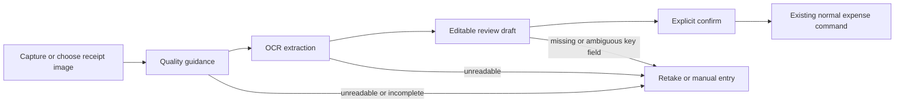

# SaveMon — Feature Specification

## 1. Purpose

This document defines the functional features of SaveMon.

It translates the product definition into concrete capabilities that can be implemented, tested, and reviewed.

This document does not define:

- Database schema
- REST API contracts
- Java classes
- Flutter implementation
- Infrastructure
- Detailed domain model

Those concerns are defined in later architecture and technical design documents.

---

# 2. Feature Classification

Features are classified as:

- **MVP** — required for the initial product
- **POST-MVP** — planned after MVP
- **FUTURE** — exploratory or advanced capability

---

# 3. Identity & Access

## F-001 — User Registration

**Priority:** MVP

### Purpose

Allow a new user to create a SaveMon account.

### Main Flow

```text
User
 ↓
Enter registration information
 ↓
Validate input
 ↓
Create account
 ↓
Account becomes available for authentication
```

### Functional Requirements

- User can provide required registration information.
- System validates required fields.
- System prevents duplicate accounts according to the configured identity rule.
- Password credentials must be stored securely.
- Invalid registration requests must be rejected.

### Acceptance Criteria

- Valid registration creates a new user.
- Duplicate identity information is rejected.
- Invalid input is rejected.
- Password is never stored in plaintext.

---

## F-002 — User Authentication

**Priority:** MVP

### Purpose

Allow registered users to securely access SaveMon.

### Functional Requirements

- User can authenticate with valid credentials.
- Invalid credentials are rejected.
- Authenticated requests must carry valid authentication context.
- Protected resources require authentication.
- Access tokens follow the configured stateless authentication strategy.

### Acceptance Criteria

- Valid credentials result in an authenticated session.
- Invalid credentials cannot authenticate.
- Unauthenticated users cannot access protected resources.

---

## F-003 — User Profile

**Priority:** MVP

### Functional Requirements

User can:

- View profile information.
- Update supported profile information.

### Acceptance Criteria

- User can retrieve their own profile.
- User cannot modify another user's profile.
- Invalid profile data is rejected.

---

# 4. Personal Finance

## F-004 — Personal Account

**Priority:** MVP

### Purpose

Allow users to manage financial accounts used to record money movements.

Examples:

- Cash
- Bank account
- E-wallet

### Functional Requirements

User can:

- Create an account.
- View accounts.
- Update account information.
- Archive/deactivate an account where applicable.
- View account balance.

### Business Rules

- An account belongs to a user.
- A user cannot access another user's account.
- Account balance must remain consistent with financial transactions.

### Acceptance Criteria

- User can create a personal account.
- User can view their own accounts.
- Unauthorized account access is rejected.
- Financial operations cannot create inconsistent account state.

---

# 5. Categories

## F-005 — Category Management

**Priority:** MVP

### Purpose

Allow users to classify transaction items.

### Functional Requirements

User can:

- Create a category.
- Rename a category.
- Archive/deactivate a category where applicable.
- Organize categories hierarchically.

### Business Rules

- A category may optionally have a parent category.
- Category hierarchy must remain valid.
- Categories used by historical transactions must not be destructively removed in a way that breaks historical data.

### Acceptance Criteria

- User can create categories.
- User can create child categories.
- Invalid parent relationships are rejected.
- Historical transactions remain understandable after category changes.

---

# 6. Income & Expense

## F-006 — Record Income

**Priority:** MVP

### Purpose

Allow users to record incoming money.

### Functional Requirements

User can provide:

- Account
- Amount
- Date
- Optional description
- Transaction items where applicable

### Business Rules

- Amount must be valid and positive.
- Account must belong to the authorized user.
- Financial state must be updated atomically.
- Invalid requests must not partially modify financial state.

### Acceptance Criteria

- Valid income can be recorded.
- Invalid amount is rejected.
- Unauthorized account is rejected.
- Failed transactions do not leave partial financial state.

---

## F-007 — Record Expense

**Priority:** MVP

### Purpose

Allow users to record outgoing money.

### Functional Requirements

User can provide:

- Account
- Amount
- Date
- Category information
- Optional description
- Transaction items where applicable

### Business Rules

- Amount must be valid and positive.
- Account must belong to the authorized user.
- Transaction items must be consistent with the transaction.
- Financial state must be updated atomically.

### Acceptance Criteria

- Valid expense can be recorded.
- Invalid amount is rejected.
- Unauthorized account is rejected.
- Invalid category information is rejected.
- Failed operations do not partially update financial state.

---

# 7. Transaction Items

## F-008 — Transaction Itemization

**Priority:** MVP

### Purpose

Allow a transaction to contain multiple detailed items.

Example:

```text
Transaction = 500,000

Items:
Food       300,000
Transport  100,000
Other      100,000
```

### Business Rules

- Transaction items belong to their parent transaction.
- Item amounts must be valid.
- The sum of item amounts must satisfy the transaction's financial rules.
- Category may be associated at item level.

### Acceptance Criteria

- Transaction can contain multiple items.
- Items can be categorized individually.
- Invalid item totals are rejected.
- Transaction and items are persisted consistently.

---

# 8. Transaction Management

## F-009 — Transaction History

**Priority:** MVP

### Purpose

Allow users to review historical financial activity.

### Functional Requirements

User can:

- View transactions.
- Filter by date.
- Filter by account.
- Filter by category where applicable.
- View transaction details.

### Acceptance Criteria

- User sees only authorized transactions.
- Filters return correct results.
- Transaction details are consistent with stored financial state.

---

## F-010 — Edit Transaction

**Priority:** MVP

### Functional Requirements

User can update supported transaction information.

### Business Rules

- User must have permission to modify the transaction.
- Financial calculations must be recalculated consistently.
- Historical data must remain valid.

### Acceptance Criteria

- Authorized user can modify an eligible transaction.
- Unauthorized modification is rejected.
- Financial state remains consistent after modification.

---

## F-011 — Delete / Reverse Transaction

**Priority:** MVP

### Purpose

Allow correction of incorrectly recorded transactions.

### Product Decision

Deletion behavior must preserve financial consistency and historical integrity.

Implementation strategy is intentionally deferred to domain design.

### Acceptance Criteria

- Authorized user can correct an eligible transaction.
- Unauthorized modification is rejected.
- Account state remains consistent.

---

# 9. Calendar & Financial Overview

## F-012 — Calendar Transaction View

**Priority:** MVP

### Purpose

Allow users to review financial activity by date.

### Functional Requirements

User can:

- Navigate by month.
- View transactions associated with a date.
- View daily totals where applicable.

### Product Rule

SaveMon does not require a dedicated calendar data entity.

Calendar views are derived from transaction dates.

---

## F-013 — Basic Financial Summary

**Priority:** MVP

### Purpose

Provide a simple overview of financial activity.

### Examples

- Total income.
- Total expenses.
- Net movement.
- Spending by category.

### Acceptance Criteria

- Summary is calculated from authorized financial data.
- Results respect selected date ranges.
- Calculations are consistent with transaction data.

---

# 10. Shared Vault

## F-014 — Create Shared Vault

**Priority:** MVP

### Purpose

Allow multiple users to manage a shared pool of money.

### Functional Requirements

User can:

- Create a vault.
- Define basic vault information.
- Become a member of the vault.

### Acceptance Criteria

- Authorized user can create a vault.
- Creator becomes an eligible member according to product rules.
- Unauthorized users cannot access the vault.

---

# 11. Vault Members

## F-015 — Manage Vault Members

**Priority:** MVP

### Functional Requirements

Eligible vault members can:

- View members.
- Add/invite members according to the membership model.
- Remove members when allowed.

### Business Rules

- Only eligible users can access a vault.
- A user cannot participate in a vault transaction without valid membership.
- Membership changes must not corrupt historical financial data.

### Acceptance Criteria

- Authorized membership operations succeed.
- Unauthorized operations are rejected.
- Non-members cannot access protected vault information.

---

# 12. Contribution

## F-016 — Record Vault Contribution

**Priority:** MVP

### Purpose

Track money contributed to a shared vault.

### Functional Requirements

A member can record a contribution.

Contribution information includes:

- Contributor
- Amount
- Date
- Vault
- Optional description

### Business Rules

- Contributor must be a valid vault member.
- Amount must be positive.
- Contribution must be associated with the correct vault.
- Financial state must be updated atomically.

### Acceptance Criteria

- Valid contribution can be recorded.
- Non-member contribution is rejected.
- Invalid amount is rejected.
- Contribution is reflected consistently in vault financial state.

---

# 13. Shared Expense

## F-017 — Record Shared Expense

**Priority:** MVP

### Purpose

Record expenses paid from or associated with a shared vault.

### Functional Requirements

A valid shared expense must identify:

- Vault
- Amount
- Date
- Expense information
- Relevant participants

### Business Rules

- Vault must exist.
- Actor must have appropriate vault permission.
- Participants must be valid vault members.
- Financial state must remain consistent.

### Acceptance Criteria

- Valid shared expense can be recorded.
- Non-member participant is rejected.
- Unauthorized vault operation is rejected.
- Shared expense is persisted atomically.

---

# 14. Expense Split

## F-018 — Split Shared Expense

**Priority:** MVP

### Purpose

Represent how a shared expense is allocated among participants.

### Business Rules

- Every participant must be an eligible vault member.
- Each participant's allocated amount must be valid.
- Total split amount must equal the expense amount.

```text
sum(split amounts) == transaction amount
```

### Acceptance Criteria

- Valid split is accepted.
- Split total mismatch is rejected.
- Invalid participant is rejected.
- Negative or invalid split amount is rejected.

---

# 15. Member Responsibility

## F-019 — View Member Financial Responsibility

**Priority:** MVP

### Purpose

Show the financial responsibility associated with shared activities.

The system should be able to determine information such as:

- Contributions
- Shared expenses
- Allocated responsibility
- Current balance/responsibility

### Important Boundary

This feature does not automatically imply debt settlement.

Settlement is a separate feature.

---

# 16. Settlement

## F-020 — Shared Expense Settlement

**Priority:** POST-MVP

### Purpose

Allow members to reconcile outstanding shared financial responsibilities.

Potential capabilities:

- Record settlement.
- Track who paid whom.
- Calculate outstanding balances.
- Track settlement history.

Settlement rules require additional domain analysis and are intentionally excluded from MVP implementation.

---

# 17. Receipt & File

## F-021 — Receipt Attachment

**Priority:** POST-MVP

### Purpose

Allow users to attach receipt images/files to financial transactions.

### Product Rules

- Receipt metadata is associated with the transaction.
- Actual files should be stored outside the relational database.
- File access must respect transaction/user authorization.

---

# 18. AI Features

## F-022 ? Restaurant & Cafe Receipt Extraction

- Description: Premium restaurant/cafe receipt capture that creates an editable, nonfinancial expense draft.

| Item | Requirement |
| --- | --- |
| Priority | FUTURE / L1 |
| Supported input | One still restaurant/cafe receipt image; supported JPEG/PNG limits and validation are defined by the scan contract. |
| Access | Active paid monthly/yearly entitlement only; no trial, grace period, free scan allowance, or client-side entitlement authority. |
| AI role | AI-assisted extraction only; output is a proposal, never financial truth. |
| Excluded | Receipt attachment retention, automatic posting, payment execution, and unsupported QR interpretation. |

- Description: User journey and recovery behavior.



- Description: Capture and review rules.

| Area | Requirement |
| --- | --- |
| Capture guidance | Tell the user to include the full bill, keep it flat, sharp, well lit, and free of glare; allow retake or choosing another image. |
| Extraction result | Propose merchant, paid total, currency, and bill date only when supported by visible evidence; expose missing or ambiguous key fields. |
| Ambiguity | Never invent a missing/ambiguous paid total, currency, date, merchant, category, context, or time. The user corrects fields or uses manual entry. |
| Review | Every proposed value is editable. No financial record is created during capture, extraction, or review. |
| Confirmation | User explicitly confirms through the existing personal/shared expense command with its own idempotency key and ordinary validation. |
| Date/category | Keep established date-only handling and existing personal/shared category rules unchanged. |
| Failure | Show a recoverable outcome: retake, choose another image, or manual entry; do not silently retry or persist a partial financial record. |
| Privacy | Source image and unconfirmed draft are volatile and deleted on cancel, leave, process close, or failed scan; no image/draft retention, backup, training, or scan-content analytics. |

- Description: QR boundary rules.

| Area | Requirement |
| --- | --- |
| Separation | Receipt OCR and QR handling are separate flows. |
| QR safety | Unknown, payment, URL, deep-link, uncertain, or unapproved QR content is rejected and never forwarded to OCR. |
| Availability | Bill QR remains unavailable until a versioned static bill-format allowlist and fixtures are approved. |

- Description: Acceptance criteria for the approved product behavior.

| ID | Given | When | Then |
| --- | --- | --- | --- |
| AC-022-01 | An active Premium user | Provides a clear restaurant/cafe receipt | The app presents an editable draft; no expense exists before explicit confirmation. |
| AC-022-02 | A receipt is blurry, cropped, glared, or unreadable | Capture or extraction cannot produce usable evidence | The app offers retake/another image/manual entry and creates no expense. |
| AC-022-03 | A key field is missing or ambiguous | The draft is displayed | The field is marked for user correction; the app does not fabricate a value. |
| AC-022-04 | A user edits or accepts a draft | They explicitly confirm | The existing normal expense command performs all financial validation and persistence. |
| AC-022-05 | A non-Premium or unverifiable user | Attempts receipt scanning | The server denies the scan; manual expense entry remains available. |
| AC-022-06 | A scan is cancelled, abandoned, fails, or the process closes | Cleanup occurs | The unconfirmed image and draft are not retained. |
| AC-022-07 | An image contains a QR candidate that is unsupported, uncertain, payment-related, a URL, or a deep link | It is examined | The whole input is rejected and OCR does not run. |

- Description: External decisions retained outside this approved product scope.

| Decision | Status | Production impact |
| --- | --- | --- |
| OCR provider, processing region, no-retention/no-training terms, transport, and privacy/cross-border terms | OPEN | External receipt OCR remains disabled. |
| Authoritative paid-entitlement source and server integration | OPEN | Production receipt scanning remains disabled. |
| Per-scan cost ceiling, operator budget, reservation, and breaker | OPEN | Paid OCR dispatch remains disabled. |
| Bill QR markets, exact versioned formats, and parser fixtures | OPEN | Bill QR remains disabled. |
| Ingress no-durable-buffer evidence and QR residual-risk approval | OPEN | Relevant production scan path remains disabled. |

## F-023 — Natural Language Transaction Entry

**Priority:** FUTURE / L1-L2

### Example

```text
"Ăn trưa 80k ở Phở Thìn"
```

AI converts natural language into a structured transaction intent.

```text
Intent
├── type = EXPENSE
├── amount = 80000
├── description = "Ăn trưa"
└── merchant = "Phở Thìn"
```

The intent must then pass through the normal application workflow.

---

## F-024 — AI Financial Assistant

**Priority:** FUTURE / L2

### Purpose

Allow users to ask questions about authorized financial information.

Examples:

- Spending this month.
- Largest expenses.
- Category trends.
- Comparison between periods.

The assistant is read-oriented and must respect authorization boundaries.

---

## F-025 — AI Agent with Tools

**Priority:** FUTURE / L3

### Purpose

Allow AI to plan and execute controlled workflows using approved tools.

Architecture:

```text
User
 ↓
Agent
 ↓
Structured Intent
 ↓
Approved Tool
 ↓
Authorization
 ↓
Validation
 ↓
Application Service
 ↓
Transaction
 ↓
Audit
```

The agent cannot directly access the database.

---

## F-026 — Autonomous Financial Workflows

**Priority:** FUTURE / L4

This feature may allow limited autonomous workflows under explicit safety policies.

Financially sensitive operations should retain appropriate approval mechanisms.

---

# 19. Cross-Cutting Requirements

The following requirements apply across financial features.

## 19.1 Authorization

Every protected operation must verify that the acting user has permission to access the target resource.

## 19.2 Validation

Business rules must be enforced by deterministic application/domain logic.

AI-generated input must be treated as untrusted input.

## 19.3 Transaction Consistency

Financial operations that modify related financial state must be atomic.

Partial financial updates are not acceptable.

## 19.4 Idempotency

Operations susceptible to mobile retries or duplicate submissions should support idempotency.

The exact mechanism is defined during technical design.

## 19.5 Auditability

Security-sensitive and financially significant operations should be auditable.

Detailed audit requirements are defined during architecture design.

## 19.6 AI Safety

AI must never:

- Directly access the database.
- Bypass authorization.
- Bypass validation.
- Execute arbitrary code.
- Directly mutate financial state.

---

# 20. MVP Feature Summary

| ID    | Feature                            | Priority |
| ----- | ---------------------------------- | -------- |
| F-001 | User Registration                  | MVP      |
| F-002 | User Authentication                | MVP      |
| F-003 | User Profile                       | MVP      |
| F-004 | Personal Account                   | MVP      |
| F-005 | Category Management                | MVP      |
| F-006 | Record Income                      | MVP      |
| F-007 | Record Expense                     | MVP      |
| F-008 | Transaction Itemization            | MVP      |
| F-009 | Transaction History                | MVP      |
| F-010 | Edit Transaction                   | MVP      |
| F-011 | Delete / Reverse Transaction       | MVP      |
| F-012 | Calendar Transaction View          | MVP      |
| F-013 | Basic Financial Summary            | MVP      |
| F-014 | Create Shared Vault                | MVP      |
| F-015 | Manage Vault Members               | MVP      |
| F-016 | Record Vault Contribution          | MVP      |
| F-017 | Record Shared Expense              | MVP      |
| F-018 | Split Shared Expense               | MVP      |
| F-019 | Member Financial Responsibility    | MVP      |
| F-020 | Settlement                         | POST-MVP |
| F-021 | Receipt Attachment                 | POST-MVP |
| F-022 | Smart Receipt Extraction           | FUTURE   |
| F-023 | Natural Language Transaction Entry | FUTURE   |
| F-024 | AI Financial Assistant             | FUTURE   |
| F-025 | AI Agent with Tools                | FUTURE   |
| F-026 | Autonomous Financial Workflows     | FUTURE   |

---

# 21. Feature Dependency

The MVP implementation should follow these dependencies:

```text
Identity
   ↓
Personal Account
   ↓
Category
   ↓
Transaction
   ├── Income
   ├── Expense
   └── Transaction Item
   ↓
Transaction History
   ↓
Calendar / Summary
```

Shared finance depends on the core financial model:

```text
Identity
   ↓
Shared Vault
   ↓
Vault Membership
   ↓
Contribution
   ↓
Shared Expense
   ↓
Expense Split
   ↓
Member Responsibility
```

AI depends on the deterministic foundation:

```text
Deterministic Financial Core
          ↓
      AI Extraction
          ↓
      AI Assistant
          ↓
      AI Agent
          ↓
 Autonomous Workflows
```

AI must not become a prerequisite for the core financial product.
