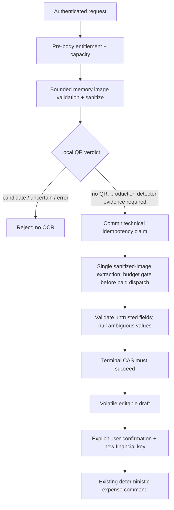

# Online scan integration slice

- Document scope and canonical sources.

| Item | Value |
| --- | --- |
| Version / updated | 3.1.0 / 2026-10-18 |
| Scope | F-022 / AC-022-01–07 restaurant/cafe receipt capture and review; not offline narrative F-023/033/034 |
| Status | Bounded implementation design; production integrations remain disabled |
| Product | [FEATURES.md](../FEATURES.md), F-022 |
| Online scan contract | [AI-ARCHITECTURE.md](../AI-ARCHITECTURE.md), section 5 |
| HTTP / errors | [API-CONTRACT.md](../API-CONTRACT.md); [errors.yaml](../contracts/errors.yaml) |
| Boundary / gates | [ADR-006](../adr/ADR-006-qr-bill-scan-boundary.md); [OPEN-DECISIONS.md](../OPEN-DECISIONS.md), OD-01–07 |
| Persistence | Existing scan idempotency only; no image, draft, receipt attachment, or financial schema changes |

- Established boundaries remain unchanged.

| Area | Rule |
| --- | --- |
| Access | Server-authoritative active paid monthly/yearly entitlement; absent/unverifiable authority fails closed before request body |
| AI | Evidence-only proposal; no financial DB/repository/command handles; no invented missing/ambiguous values |
| Input | Exactly one JPEG/PNG; file ≤8 MiB, request ≤8.25 MiB, decoded ≤12 MP; reject unsupported parts/frames/content |
| Lifetime | Image/draft memory-only; no logging, analytics, backup, restoration, outbox, or receipt attachment |
| QR | Local boundary before OCR; candidate/uncertain/error rejects whole input; empty bill-format allowlist; no fetch or OCR fallback |
| Resources | Two in-flight scans per instance; one extraction call ≤15s; total request ≤20s; no automatic retry/escalation |
| Idempotency | Commit SHA-256-only claim before extraction; terminal CAS before returning draft; 30-day keys, stale IN_PROGRESS CAS after 60s |
| Replay | Concurrent: existing in-progress error; mismatch: existing mismatch error; terminal: SCAN_ALREADY_PROCESSED, no draft recovery |
| Confirmation | Existing personal/shared command; independent financial key; normal authorization/money/currency/account/membership/split validation |
| Date / category | Preserve disclosed synthetic 12:00Z/DATE_ONLY mapping; personal optional category = one full-amount item; shared category absent |
| Expiry | Premium expiry after scan start does not prevent ordinary expense confirmation |

- Target flow separates nonfinancial extraction from financial execution.

- Current source gaps define the implementation boundary, not production readiness.

| Component | Observed state | Consequence |
| --- | --- | --- |
| Backend ai/application | Entitlement, idempotency, extractor seams exist; no scan coordinator | Extend existing module, not a new service/domain |
| LocalBillQrBoundary | UNSUPPORTED_QR or UNCERTAIN only; decoder miss is uncertainty | No live OCR path exists; never relabel decoder NotFound as QR-free |
| DisabledExpenseScanPreBodyFilter | Rejects before body; positive entitlement still returns unavailable | Preserve production denial while isolated pipeline is built |
| JdbcExpenseScanIdempotencyStore / V3 | Hash/status-only storage; terminal transition fails when inactive | Reuse; verify real PostgreSQL before claiming persistence correctness |
| mobile qr_bill_scan | Static scan preview; unavailable image source; repository/model scaffolding | Replace production fake-success presentation with honest unavailable/recovery states |
| ApiClient | sendMultipartFile absent although repository calls it | Repair narrowly using existing auth/URI/session conventions; no new scan API contract |

- Backend implementation is buildable without choosing external services.

| Slice | Implementation responsibility | Production boundary |
| --- | --- | --- |
| BE-1 coordinator | ai/application orchestrates injected entitlement, bounded image validation, QR verdict, idempotency, extractor, clock/deadline/cancellation; no financial writes | Exercise directly with test fakes; do not register an accepting HTTP endpoint |
| BE-2 image validation | Header/dimension checks before raster allocation; reject malformed/decompression/animated input; sanitize metadata; bounded memory-only streams/encoders; release on every exit | No servlet multipart resolver/native SDK assumption; no disk-cache fallback |
| BE-3 QR seam | Explicit local verdict including test-only NO_QR; bind current conservative implementation as rejecting/uncertain | NO_QR from test fixtures is not a production detector; replacement requires OD-05 evidence |
| BE-4 output validation | Existing response shape; decimal strings, supported money/currency rules, real civil date, merchant ≤500 code points; missing/ambiguous required fields=null+listed; wholly unreadable/unrelated existing outcomes | No repair, inferred category/context/time, tax arithmetic guess, extra VAT schema, or new error codes |
| BE-5 lifecycle | Claim before extraction; one call; timeout/cancel/disconnect fails claim; late result discarded; terminal CAS failure returns unavailable/no draft | Keep capacity until underlying work ends; a timeout does not prove a provider stopped |
| BE-6 HTTP preparation | Test exact existing path/header/body/response/error mapping and auth/entitlement-before-read; isolated in-memory request harness only | Existing disabled filter remains; enabling real upload requires ingress/servlet proof and relevant owner gates |

- Flutter uses the existing Riverpod feature and normal financial forms.

| Slice | Implementation responsibility | Production boundary |
| --- | --- | --- |
| FE-1 contracts | Retain feature directory, repository and existing routes; injectable scan/image-source seams; strict response validation and known error mapping | No paid flag treated as server authority; unknown availability denies scan, manual entry stays available |
| FE-2 transport | Repair missing multipart API with bounded image bytes, existing bearer/session handling, relative URI checks, no cross-origin redirect forwarding, cancellation, no body logging/retry | Transport existence does not enable scan or substitute entitlement source |
| FE-3 state | Auto-disposed subject-scoped controller: unavailable/guidance/selecting/ready/submitting/review/error/confirming; request generation fences; no disk serialization | Production image source stays unavailable until native memory/temp-file behavior is approved and verified |
| FE-4 capture | Full-bill/flat/sharp/light/no-glare guidance; retake/another image/manual actions; user chooses input deliberately | No simulated camera feed, fabricated OCR success, or automatic background scanning |
| FE-5 review | Editable evidence fields, missing-field warnings, explicit date-only disclosure; select account or shared context manually through existing forms | No invented amount/currency/date/category/context; unsupported shared category stays absent |
| FE-6 confirm | Explicit action hands reviewed values to existing personal/shared form/command using separate financial key; preserve current financial unknown-result/idempotency handling | No new scan-confirm/retrieve endpoint; never place scan image/draft in offline outbox |
| FE-7 lifecycle | Cancel/leave/background/subject-lock/switch/logout disposes bytes/draft, aborts work and fences late completion; process close cannot restore draft | Best-effort memory release, not guaranteed heap zeroization; existing source gallery photo is not deleted |
| FE-8 previews | Widget tests inject fixtures; clearly labelled isolated previews may show extraction/recovery states | No fake success adapter registered in production; result route without volatile draft shows recovery, not fixture data |

- Smallest execution order avoids dependencies on unresolved production choices.

| Order | Owner | Deliverable | Depends on |
| --- | --- | --- | --- |
| 1A | backend-developer | BE-1–5 isolated orchestration/validation and focused tests; disabled runtime retained | Existing contracts only |
| 1B | frontend-developer | FE-1–5/7–8 volatile guided capture/review/recovery and transport repair; widget tests | Existing contracts; independent of 1A through test fixtures |
| 2 | backend-developer / frontend-developer, separately routed | BE-6 isolated contract harness; FE-6 normal-command handoff | 1A/1B; existing personal/shared commands |
| 3 | qa-qc | Focused pipeline, widget, contract, privacy-lifecycle, PostgreSQL checks; verify no public scan activation | Implemented slices; disposable DB/device only where needed |
| 4 | devops then reviewer | Commit/push only scoped files on dev; review against F-022 and disabled boundaries | Required checks; no branches, promotions, or unrelated changes |
| Later | Owner + security/ops + specialists | Approved real adapters, detector/image-source evidence, protected production enablement | Relevant OD gates; separate implementation/review |

- Required verification is evidence to collect, not a claim that checks ran.

| Area | Focused checks |
| --- | --- |
| Access | 401/403/503; no body read, source capture, or extraction under denied/unavailable paths |
| Image / QR | Bytes/pixels/MIME/signature/frames/bombs; metadata removal; all QR-candidate/uncertain/error paths make zero extraction calls |
| Draft | Decimal/date/currency/merchant bounds; missing/ambiguous totals; subtotal versus paid total; injection/unknown fields; no financial side effects |
| Concurrency | Two-slot release; same-key concurrency/mismatch/terminal/expiry/stale CAS; timeout/late result/terminal DB failure; no automatic retry |
| Mobile | Editable fields, keyboard/small viewport/large text, missing-value confirmation blocked, manual fallback, result route without draft, no duplicate financial submit |
| Privacy | Cancel/leave/background/lock/logout/subject switch, delayed completions, no image/draft restoration/storage/logs/outbox; production fake adapters absent |
| Restaurant corpus | Synthetic or consented de-identified receipts: cafe/table-service/takeaway, Vietnamese accents, glare/blur/crop/rotation, discounts/VAT/service fee, ambiguous totals, printed payment QR |
| Evaluation | Existing targets: 200 supported +100 adversarial receipts, amount ≥95%, ambiguity recall ≥99%; fixture success is not vendor/detector/device qualification |

- Open production gates remain owner decisions, not implementation assumptions.

| Gate | Still required | Safe work meanwhile |
| --- | --- | --- |
| OD-01 | Paid entitlement authority/trusted integration | Disabled adapter; server gate tests |
| OD-02 | Exact versioned static bill QR formats/fixtures | Empty allowlist; rejection tests |
| OD-03/06 | OCR provider/region/no-retention/no-training/transport/privacy/cross-border approval | Extractor interface/output validator; no external images |
| OD-04 | Worst-case cost ceiling, operator budget/reservation/breaker | No paid dispatch; no invented user quota or cost policy |
| OD-05 | Detector residual-risk acceptance; memory-only ingress/servlet/SDK evidence | Isolated pipeline; conservative QR rejection; disabled public upload |
| Native capture evidence | Package/permissions/platform and temporary-file/cache behavior must satisfy approved volatile policy | Unavailable source + injected in-memory fixtures; no package choice made here |
