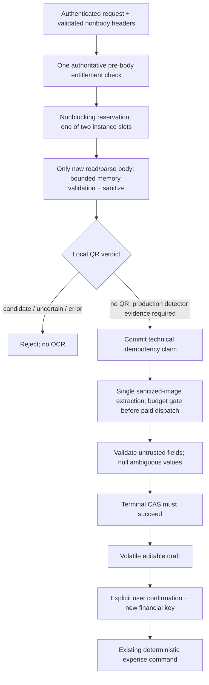

# Online scan integration slice

- Document scope and canonical sources.

| Item | Value |
| --- | --- |
| Version / updated | 3.4.0 / 2026-10-18 |
| Scope | F-022 / AC-022-01–07 restaurant/cafe receipt capture and review; not offline narrative F-023/033/034 |
| Status | Bounded implementation design; production integrations remain disabled |
| Product | [FEATURES.md](../FEATURES.md), F-022 |
| Online scan contract | [AI-ARCHITECTURE.md](../AI-ARCHITECTURE.md), section 5 |
| HTTP / errors | [API-CONTRACT.md](../API-CONTRACT.md); [errors.yaml](../contracts/errors.yaml) |
| Boundary / gates | [ADR-006](../adr/ADR-006-qr-bill-scan-boundary.md); [OPEN-DECISIONS.md](../OPEN-DECISIONS.md), OD-01–07 |
| Persistence | Existing scan idempotency only; no image, draft, receipt attachment, or financial schema changes |

- Established boundaries remain unchanged.

| Area | Rule |
| --- | --- |
| Access | One server-authoritative entitlement check per new request before body; active paid monthly/yearly only; absent/unverifiable authority fails closed |
| AI | Evidence-only proposal; no financial DB/repository/command handles; no invented missing/ambiguous values |
| Input | Exactly one JPEG/PNG; file ≤8 MiB, request ≤8.25 MiB, decoded ≤12 MP; reject unsupported parts/frames/content |
| Lifetime | Image/draft memory-only; no logging, analytics, backup, restoration, outbox, or receipt attachment |
| QR | Local boundary before OCR; candidate/uncertain/error rejects whole input; empty bill-format allowlist; no fetch or OCR fallback |
| Resources | Reserve one of two instance slots before any body read/parse; one extraction call ≤15s; total request ≤20s including input; no automatic retry/escalation |
| Idempotency | Commit SHA-256-only claim before extraction; terminal CAS before returning draft; 30-day keys, stale IN_PROGRESS CAS after 60s |
| Replay | Concurrent: existing in-progress error; mismatch: existing mismatch error; terminal: SCAN_ALREADY_PROCESSED, no draft recovery |
| Confirmation | Existing personal/shared command; independent financial key; normal authorization/money/currency/account/membership/split validation |
| Date / category | Preserve disclosed synthetic 12:00Z/DATE_ONLY mapping; personal optional category = one full-amount item; shared category absent |
| Expiry | Accepted pre-body admission fixes entitlement eligibility for that scan; expiry/outage afterward does not invalidate its draft or later ordinary expense confirmation; each new request rechecks |

- Target flow separates nonfinancial extraction from financial execution.

- Initial source assessment records the baseline before bounded implementation, not production readiness.

| Component | Observed state | Consequence |
| --- | --- | --- |
| Backend ai/application | Entitlement, idempotency, extractor seams exist; no scan coordinator | Extend existing module, not a new service/domain |
| LocalBillQrBoundary | UNSUPPORTED_QR or UNCERTAIN only; decoder miss is uncertainty | No live OCR path exists; never relabel decoder NotFound as QR-free |
| DisabledExpenseScanPreBodyFilter | Rejects before body; positive entitlement still returns unavailable | Preserve production denial while isolated pipeline is built |
| JdbcExpenseScanIdempotencyStore / V3 | Hash/status-only storage; terminal transition fails when inactive | Reuse; verify real PostgreSQL before claiming persistence correctness |
| mobile qr_bill_scan | Static scan preview; unavailable image source; repository/model scaffolding | Replace production fake-success presentation with honest unavailable/recovery states |
| ApiClient | sendMultipartFile absent although repository calls it | Repair narrowly using existing auth/URI/session conventions; no new scan API contract |

- Backend implementation is buildable without choosing external services.

| Slice | Implementation responsibility | Production boundary |
| --- | --- | --- |
| BE-1 coordinator | Single lazy-body entry owns one pre-body entitlement decision, instance slot, image validation, QR verdict, idempotency, extractor, clock/deadline/cancellation; no financial writes | Exercise directly with test fakes; do not register an accepting HTTP endpoint |
| BE-2 image validation | Header/dimension checks before raster allocation; reject malformed/decompression/animated input; sanitize metadata; bounded memory-only streams/encoders; release on every exit | No servlet multipart resolver/native SDK assumption; no disk-cache fallback |
| BE-3 QR seam | Explicit local verdict including test-only NO_QR; bind current conservative implementation as rejecting/uncertain | NO_QR from test fixtures is not a production detector; replacement requires OD-05 evidence |
| BE-4 output validation | Existing response shape; decimal strings, supported money/currency rules, real civil date, merchant ≤500 code points; missing/ambiguous required fields=null+listed; wholly unreadable/unrelated existing outcomes | No repair, inferred category/context/time, tax arithmetic guess, extra VAT schema, or new error codes |
| BE-5 lifecycle | Claim before extraction; one call; timeout/cancel/disconnect fails an existing claim; late result discarded; terminal CAS failure returns unavailable/no draft | Release slot exactly once only after request finalization AND underlying work termination; a timeout does not prove a provider stopped |
| BE-6 HTTP preparation | Test exact path/header/body/response/error mapping; harness authenticates without body, then delegates lazy parsing to coordinator-owned admission; no second entitlement gate | Existing disabled filter remains; harness never chains through it; enabling real upload requires ingress/servlet proof and owner gates |

- Reviewer correction for e7092b9 makes admission single-owner and body acquisition lazy.

| Seam | Required implementation |
| --- | --- |
| Entry | ExpenseScanCoordinator.scan(subject, scanKey, lazyInput, cancelled): trusted in-process lazyInput produces bounded source bytes + declared image media type; names may follow existing style |
| Trust | Caller supplies authenticated UUID subject and validated UUID key; admission is not a client flag or serializable token; no public bypass/skip-entitlement boolean or eager already-read HTTP entry |
| Ordering | Start monotonic request deadline → one authoritative entitlement check → nonblocking shared instance-slot reservation → cancellation/deadline check → invoke lazyInput once → image/QR/claim/extraction/terminal steps |
| Harness | Validate exact route/auth/nonbody header values; pass supplier without invoking it; remove duplicate harness entitlement query; parse multipart structure/file bytes only inside admitted supplier |
| No policy change | Active entitlement at admission is sufficient for that request; never requery after input acquisition or before extraction; another request, even with same key, needs its own admission |
| Saturation | One shared two-slot gate per application instance, never per request/harness call; third request while two leases remain occupied returns existing 503 SCAN_CAPACITY_UNAVAILABLE before supplier/stream/multipart access; do not queue body readers |
| Input contract | lazyInput does not retain/log/spool source; exceptions leave through canonical error mapper; no eager supplier evaluation in argument expressions; no accepting route or production upload change |
| Budget | Existing independent dispatch/cost gate still applies before extraction; one-time entitlement admission does not bypass cost/security/deadline controls |

- Admission owns cleanup across parsing, orchestration and any worker.

| Exit / ownership | Required lifecycle |
| --- | --- |
| Denied / unavailable entitlement | No lease/body/claim/extraction; existing 403 PREMIUM_REQUIRED or 503 PREMIUM_ENTITLEMENT_UNAVAILABLE mapping |
| Capacity denial | No lease acquired, no supplier invoked, no claim/extraction; existing capacity mapping |
| Parse/read/image failure before claim | Release request buffers and slot exactly once; no idempotency failure write for nonexistent claim; map known size/media/validation errors through existing catalog |
| Cancel/disconnect/deadline before claim | Stop reads/processing cooperatively, release only after reader/parser actually terminates; no further pipeline steps or claim; no response promise after socket disconnect |
| Claim acquired; worker absent | Error/cancel fails only owned claim, fences output, disposes buffers and finalizes lease; terminal-store failure must not return draft |
| Worker submitted | Request and worker jointly retain lease; normal worker completion alone cannot release it while terminal CAS/request cleanup is unfinished |
| Timeout/cancel/disconnect with worker active | Fence/discard late result; fail owned claim; signal supported cooperative cancellation; request may finish but slot remains occupied until underlying task actually terminates; no release on Future.cancel/isDone alone |
| Successful request | Validate output, win terminal CAS, finish request cleanup; release when worker has terminated too; expose no draft on lost/failed terminal CAS |
| Release guard | One internal exactly-once lease owner tracks request-finalized AND all dispatched work-terminated; submission failure closes only request-owned resources; worker/caller races cannot double-release |
| Unexpected supplier error | Cleanup still executes; map through existing canonical unexpected-error handling without leaking exception/body; no invented entitlement error after admission |

- Focused regression tests prove admission ordering without enabling HTTP ingestion.

| Test | Required assertion |
| --- | --- |
| Entitlement changes after admission | Fake returns ACTIVE once, then INACTIVE/unavailable if queried again; supplier advances paid expiry/changes fake; valid scan still completes and query count is exactly one |
| Initial denial | Inactive/unavailable fake returns existing 403/503; query count one, supplier reads zero, no claim/extraction |
| Two admitted slow readers | Block two suppliers after admission; third has zero supplier calls and existing capacity response; proves capacity includes upload, not just extraction |
| Two uninterruptible extractors | Let callers time out/cancel; third still reads zero until underlying workers end; no late draft, no slot over-release |
| Terminal CAS pending | Complete extraction but block request terminal store; its slot remains occupied until request finalization |
| Parse failure | Supplier throws expected validation/size/media failure and unexpected error; release exactly once; two subsequent requests can enter; no claim/provider call |
| Parse cancellation/disconnect | Cancel before supplier, and while cooperative supplier is blocked; no downstream execution; occupied reader retains capacity until termination |
| Worker submission failure | Rejected executor causes cleanup/failure of owned claim; no retained slot/buffers or false draft |
| Existing safety | Retain QR candidate rejection, idempotency/CAS, output validation and disabled production filter tests; no accepting controller/servlet or production fake success |

- Flutter uses the existing Riverpod feature and normal financial forms.

| Slice | Implementation responsibility | Production boundary |
| --- | --- | --- |
| FE-1 contracts | Retain feature directory, repository and existing routes; injectable scan/image-source seams; strict response validation and known error mapping | No paid flag treated as server authority; unknown availability denies scan, manual entry stays available |
| FE-2 transport | Repair missing multipart API with bounded image bytes, existing bearer/session handling, relative URI checks, no cross-origin redirect forwarding, cancellation, no body logging/retry | Transport existence does not enable scan or substitute entitlement source |
| FE-3 state | Auto-disposed subject-scoped controller: unavailable/guidance/selecting/ready/submitting/review/error/confirming; request generation fences; no disk serialization | Production image source stays unavailable until native memory/temp-file behavior is approved and verified |
| FE-4 capture | Full-bill/flat/sharp/light/no-glare guidance; retake/another image/manual actions; user chooses input deliberately | No simulated camera feed, fabricated OCR success, or automatic background scanning |
| FE-5 review | Editable evidence fields, missing-field warnings, explicit date-only disclosure; select account or shared context manually through existing forms | No invented amount/currency/date/category/context; unsupported shared category stays absent |
| FE-6 confirm | Explicit action hands reviewed values to existing personal/shared form/command using separate financial key; preserve current financial unknown-result/idempotency handling | No new scan-confirm/retrieve endpoint; never place scan image/draft in offline outbox |
| FE-7 lifecycle | Cancel/leave/background/subject-lock/switch/logout disposes bytes/draft, aborts work and fences late completion; process close cannot restore draft | Best-effort memory release, not guaranteed heap zeroization; existing source gallery photo is not deleted |
| FE-8 previews | Widget tests inject fixtures; clearly labelled isolated previews may show extraction/recovery states | No fake success adapter registered in production; result route without volatile draft shows recovery, not fixture data |

- Smallest execution order avoids dependencies on unresolved production choices.

| Order | Owner | Deliverable | Depends on |
| --- | --- | --- | --- |
| 1A | backend-developer | BE-1–5 isolated orchestration/validation and focused tests; disabled runtime retained | Existing contracts only |
| 1B | frontend-developer | FE-1–5/7–8 volatile guided capture/review/recovery and transport repair; widget tests | Existing contracts; independent of 1A through test fixtures |
| 2 | backend-developer / frontend-developer, separately routed | BE-6 isolated contract harness; FE-6 normal-command handoff | 1A/1B; existing personal/shared commands |
| 3 | qa-qc | Focused pipeline, widget, contract, privacy-lifecycle, PostgreSQL checks; verify no public scan activation | Implemented slices; disposable DB/device only where needed |
| 4 | devops then reviewer | Commit/push only scoped files on dev; review against F-022 and disabled boundaries | Required checks; no branches, promotions, or unrelated changes |
| Later | Owner + security/ops + specialists | Approved real adapters, detector/image-source evidence, protected production enablement | Relevant OD gates; separate implementation/review |

- Required verification is evidence to collect, not a claim that checks ran.

| Area | Focused checks |
| --- | --- |
| Access | 401/403/503; no body read, source capture, or extraction under denied/unavailable paths |
| Image / QR | Bytes/pixels/MIME/signature/frames/bombs; metadata removal; all QR-candidate/uncertain/error paths make zero extraction calls |
| Draft | Decimal/date/currency/merchant bounds; missing/ambiguous totals; subtotal versus paid total; injection/unknown fields; no financial side effects |
| Concurrency | Two-slot release; same-key concurrency/mismatch/terminal/expiry/stale CAS; timeout/late result/terminal DB failure; no automatic retry |
| Mobile | Editable fields, keyboard/small viewport/large text, missing-value confirmation blocked, manual fallback, result route without draft, no duplicate financial submit |
| Privacy | Cancel/leave/background/lock/logout/subject switch, delayed completions, no image/draft restoration/storage/logs/outbox; production fake adapters absent |
| Restaurant corpus | Synthetic or consented de-identified receipts: cafe/table-service/takeaway, Vietnamese accents, glare/blur/crop/rotation, discounts/VAT/service fee, ambiguous totals, printed payment QR |
| Evaluation | Existing targets: 200 supported +100 adversarial receipts, amount ≥95%, ambiguity recall ≥99%; fixture success is not vendor/detector/device qualification |

- Open production gates remain owner decisions, not implementation assumptions.

| Gate | Still required | Safe work meanwhile |
| --- | --- | --- |
| OD-01 | Paid entitlement authority/trusted integration | Disabled adapter; server gate tests |
| OD-02 | Exact versioned static bill QR formats/fixtures | Empty allowlist; rejection tests |
| OD-03/06 | OCR provider/region/no-retention/no-training/transport/privacy/cross-border approval | Extractor interface/output validator; no external images |
| OD-04 | Worst-case cost ceiling, operator budget/reservation/breaker | No paid dispatch; no invented user quota or cost policy |
| OD-05 | Detector residual-risk acceptance; memory-only ingress/servlet/SDK evidence | Isolated pipeline; conservative QR rejection; disabled public upload |
| Native capture evidence | Package/permissions/platform and temporary-file/cache behavior must satisfy approved volatile policy | Unavailable source + injected in-memory fixtures; no package choice made here |

- FE-6 dependency assessment distinguishes approved financial contracts from current route wiring.

| Layer | Established contract / observed source | Handoff implication |
| --- | --- | --- |
| Personal API | OpenAPI TransactionCreate: POST /transactions/expense; accountId, exact amount, currency, transactionDate; optional datePrecision and items | No new endpoint/business decision required; date-only uses DATE_ONLY + synthetic 12:00Z; category remains optional |
| Personal mobile | PersonalFinanceRepository is read-only; personal_write_dialog references absent write methods/providers and supplies DateTime.now | Not a usable existing write path; do not connect scan to this dialog unchanged |
| Personal backend | PersonalFinanceController → PersonalFinanceOperations.FinancialRequest has no datePrecision; legacy JDBC writer omits it | Cannot faithfully persist scan DATE_ONLY through current route |
| Date-aware personal core | PersonalPosting + JdbcPersonalPostingStore support DATE_ONLY, exact money, ordinary validation and immutable receipt; explicitly not HTTP-wired | Reuse approved implementation after ordinary-finance integration/verification; do not call it from AI extraction |
| Shared mobile | SharedFinanceApi.createExpense currently has integer-only money and no datePrecision; shared_write_dialog supplies now/INSTANT and references newer unsupported signatures | Repair typed ordinary API/form compatibility; preserve caller choices and date; never round USD or substitute current time |
| Shared backend | SharedFinanceOperations.ExpenseRequest has no datePrecision; SharedFinanceController uses legacy operations | Same DATE_ONLY loss risk as personal route |
| Date-aware shared core | SharedLedgerCommands + JdbcSharedLedgerStore already implement DATE_ONLY, explicit funding and splits; explicitly not HTTP-wired | Integrate existing core through ordinary route after contract/rollout checks; no QR/OCR service financial access |

- Smallest FE-6 design passes transient prefills into finance-owned forms, never a scanner-owned financial writer.

| Boundary | Technical requirement |
| --- | --- |
| Prefill | In-memory immutable paidTotal decimal string, currency, civil date and optional merchant display; no image, scan key, raw QR/provider response or invented narrativeSource |
| Context | User explicitly chooses personal/shared; then account or vault; no automatic context selection |
| Personal form | Reviewed amount/currency/date editable; explicit owned active account; optional owned active category produces one full-amount item, absent category omits items; no forced category creation |
| Shared form | User explicitly selects vault, VAULT/MEMBER funding, applicable payer/source account, and participants/allocations using established split workflow; no auto choice of payer/splits; no shared category |
| Date | Preserve selected civil date through form edits/retries; display synthetic-time disclosure; submit YYYY-MM-DDT12:00:00Z and datePrecision DATE_ONLY, never DateTime.now replacement |
| Money | Convert reviewed decimal to existing ExactMoney + encodeFinancialJson numeric token; no double/int coercion; enforce established currency scale and compatible account/vault currency |
| Confirmation | Final finance-form user action invokes ordinary command with fresh independent key; freeze body/key for same-command retries and unknown results; changed values require explicit new intent/key, not automatic retry |
| Storage | Scan prefills remain volatile; ordinary confirmed command follows existing financial handling only after confirmation; never queue image or unconfirmed scan draft |
| Runtime | Finance-owned command seam may be exercised with test fakes now; production scan confirmation remains unavailable until ordinary route DATE_ONLY compatibility is verified; no test-success binding |

- The exact implementation dependency is ordinary-finance contract reconciliation, not additional OCR scope.

| Order | Custom agent | Scope / gate |
| --- | --- | --- |
| A | frontend-developer | Build volatile prefill + finance-form command interface/widget tests using fakes; no live save claim; keep scan runtime disabled |
| B | backend-developer | Assess/reconcile existing ordinary personal/shared HTTP writers with approved date-aware cores, exact request/response shapes, immutable receipt replay and atomic financial effects; no second writer, parallel ledger effects or changed endpoints |
| B verification | qa-qc | Prove DATE_ONLY persisted/read back, synthetic noon/calendar behavior, exact VND/USD, optional personal category, shared authorization/funding/splits, idempotent replay and no duplicate balance changes on disposable migrated DB |
| C | frontend-developer | Add personal recordExpense and exact/date-aware shared API support; adapt normal forms to optional transient prefills; repair only directly required signature/provider/model dependencies; retain explicit context choices |
| C verification | qa-qc | Contract/widget tests of selected receipt date and datePrecision, independent keys, missing-context validation, cancellation/session fences and unknown-result handling |
| Activation | Orchestrator + relevant specialists | Check approved migration/client rollout constraints and existing data eligibility before wiring real ordinary routes; no automatic legacy migration/backfill or production promotion; scan production gates remain separate |

- No new product decision is needed for the handoff design; real schema/client inventory, ledger migration/eligibility evidence, existing compilation gaps and OD production gates remain dependencies.

- Ordinary-expense prerequisite design reconciles existing contracts without creating an AI financial writer.

| Boundary | Required technical change / constraint |
| --- | --- |
| Personal HTTP | Existing POST /api/v1/transactions/expense binds TransactionCreate-compatible interface DTO, maps to PersonalPosting.Command, invokes PersonalPosting.record with EXPENSE, and emits stored receipt status/body/ETag unchanged; do not also call PersonalFinanceOperations.record |
| Shared HTTP | Existing POST /api/v1/vaults/{vaultId}/expenses binds ExpenseCreate-compatible DTO plus optional If-Match, maps nested funding/splits to SharedLedgerCommands.Expense, and emits CommandJournal.Receipt; do not also call SharedFinanceOperations.expense |
| DTO ownership | Interface DTOs carry exact BigDecimal/Instant/UUID values and approved optional fields; application command records remain transport-independent; reject unknown/duplicate properties through existing canonical validation |
| Date | Missing datePrecision retains INSTANT default; DATE_ONLY maps UTC civil date to noon in existing cores; today before noon is valid DATE_ONLY; no scan-only date mutation or precision loss in adapter/hash/storage |
| Personal optional fields | Preserve omitted items as unitemized; optional narrativeSource keeps its existing validation when supplied, but F-022 never manufactures it; preserve description/category semantics |
| Shared optional fields | Existing core lacks splitDerivation and expected vault version; extend its command/store boundary to carry these approved inputs rather than silently drop them; no new wire fields |
| Shared atomic validation | Under existing vault transaction/lock: authorize; replay matching prior success before fresh-version check; check supplied If-Match; recompute supplied derivation with pure SplitPreviewService, validate membership/currency and exact equality to explicit splits; persist derivation with expense/effects/receipt/audit atomically |
| Module ownership | SharedLedgerCommands/Store coordinate SharedOperationLedger application port for personal effects; interfaces and ai module never access foreign financial repositories or submit a second debit |
| Read compatibility | Personal GET/list maps stored date_precision to existing Transaction.datePrecision and returns approved version/kind fields; calendar uses existing UTC/synthetic-noon rules; shared Expense response has no datePrecision property, so verify its linked header internally without inventing a response field or inferring precision from noon |
| Routing during development | Build pure mappers/application boundary and isolated same-path MVC tests first; no duplicate registered mappings, alternate /ai writer, default production core switch, or accepting scan route |

- Schema eligibility is proven from effects and provenance, not migration version or a feature flag.

| Input state | Allowed progression |
| --- | --- |
| Disposable fresh DB | Apply original Flyway chain, including V5 expansion and relevant V6/V7 dependencies, in a new explicitly scoped test schema; existing source DB untouched; seed test data through selected ledger-aware commands, not legacy writers |
| Required structure | Verify tables/columns/constraints for date_precision, context/kind, account/vault entries, revisions, immutable receipts, audit and split derivations; reuse existing DDL; no additional migration is presumed necessary |
| Expanded legacy DB | V5 deliberately leaves old rows/response_reference values unclassified; schema.sql is fresh-install reference, never an overwrite/migration script; no blanket INSTANT/context backfill or fabricated receipts |
| Data evidence | PersonalLedgerEligibility and SharedLedgerHistory checks run under resource locks; read-only staging reconciliation supplements them; require exact projections, full effects/children/revisions, bounded unique watermarks and original immutable success evidence |
| Current core limitation | PersonalLedgerEligibility currently accepts LIVE personal history only; it is not proof that MIGRATED_CURRENT_STATE or personal accounts containing shared cash effects are supported; qualify these cases or keep them unavailable, never weaken checks to make tests pass |
| Existing migrations | Preserve V1–V8/checksums; any demonstrated missing schema support requires a separately scoped additive migration and review, not edits to applied SQL |
| Legacy conversion | Follow DATA-MODEL.md inventory/backup/write-pause/reconciliation order; ambiguous counter identities, missing receipts or unknown baselines remain unresolved; no automatic repair, destructive reset or treating empty fixtures as migration evidence |

- Writer and replay closure prevent new date-aware expenses from contaminating existing financial truth.

| Concern | Required readiness evidence |
| --- | --- |
| Sibling mutations | On every enabled account/vault, income, contributions/member-funded debits, metadata edits, reversals, archive and settlement/resource mutations must preserve their approved effects/revisions/watermarks/receipts; route through existing compatible cores or keep that mutation unavailable on the tested resource; never fall back to legacy writers after new ledger writes |
| Read closure | Ordinary detail/list/calendar/summary and shared position consumers must read the approved classified effects/metadata; legacy status-only counters must not yield a contradictory balance/history after the switch |
| Personal keys | Legacy and PersonalPosting both use PERSONAL_EXPENSE, but fingerprints/response_reference meanings differ; recognize existing rows before claiming; never interpret a domain-object UUID as an immutable receipt ID |
| Shared keys | Legacy VAULT_EXPENSE_{vaultId} and isolated LEDGER_SHARED_EXPENSE:{vaultId} are different internal namespaces for the same public intent; detect legacy successes before any new claim so namespace change cannot charge twice |
| Replay compatibility | Preserve authenticated same-intent original status/body/headers and mismatch behavior; normalize missing precision as INSTANT for new commands; any legacy-key mapping/receipt conversion must be proven from original success, not rebuilt from mutable current detail |
| Unknown old outcome | Do not reexecute under a fresh namespace/key or invent a success snapshot; fail closed through existing approved conflict handling and surface migration/reconciliation evidence gap |
| Released clients | Inventory real versions and persisted outbox commands; test existing omitted datePrecision/items/If-Match/derivation requests and exact-money responses; no new mandatory If-Match or forced category, no hidden context/funding default |
| Incompatible contract | If discovered published clients cannot tolerate approved response/validation changes, surface coordinated migration versus new-version choice to owner before activation; do not choose silently |

- Executable work proceeds in isolated tests while real-data activation remains a separate gate.

| Order | Owner | Deliverable / verification |
| --- | --- | --- |
| P1 | backend-developer | Unregistered DTO/validation + finance-owned expense-port tests only; tracked-only dependency closure per correction below; no JDBC persistence or new Spring bean registration |
| P2 | devops | Read-only schema/Flyway/client inventory for explicitly identified target; report actual deployment and backups/restore evidence, no migration/application switch |
| P3 | backend-developer | Real-core MVC + disposable PostgreSQL tests; required read projection mappings and key/replay guard; writer-closure inventory naming compatible/incompatible paths; no legacy-data repair |
| P4 | qa-qc | Independent contract+DB checks: exact VND/USD, omitted INSTANT, DATE_ONLY yesterday/today-before-noon/future, optional category, explicit funding/splits/derivation/If-Match, authorization, timeout replay, duplicate-key concurrency, terminal rollback, migration-ineligible rejection and sibling-writer interference |
| P5 | frontend-developer | Repair only required personal/shared write API/provider/form signatures; exact numeric encoding, transient receipt prefills, explicit context selections, retained DATE_ONLY and independent frozen financial intent/key; widget/transport checks |
| P6 | qa-qc | Local/disposable integrated form-to-ordinary-API proof; inspect stored date_precision and exactly one balance/ledger effect; scan extraction remains disabled |
| Commit/review | devops → reviewer | Scoped verified changes on dev, review pushed commit; no auto production promotion |
| Target activation | Orchestrator + owner/security/ops as applicable | Require schema/data/replay/writer/client evidence and explicit target selection; production migration/deployment requires its normal approval; after first new write use forward repair, not legacy-writer rollback |

- Current implementation needs no new financial/product decision; production decisions arise only from actual incompatible clients, unprovable legacy history or deployment/migration impact, while F-022 external gates stay open.

- P1 correction after review of 533cba0 supersedes its implementation scope, not the final ordinary-finance architecture.

| Inventory / rule | Established boundary |
| --- | --- |
| Tracked, per DevOps inventory | PersonalPosting, SharedLedgerCommands, PersonalExpensePostingBridge, SharedExpensePostingBridge, PersonalFinanceOperations and SharedFinanceOperations |
| Untracked, per DevOps inventory | SharedOperationLedger, CommandJournal, SharedLedgerHistory and SplitPreviewService; workspace presence grants no dependency/release authority |
| Missing closure | PersonalPosting persistence adapter is not part of the pushed P1 implementation; shared JDBC store depends on unpublished cross-module/journal/history/split types |
| Repair | New forward commit narrows newly introduced P1 code; no amend/reset/history rewrite or opportunistic inclusion of untracked finance implementations |
| Runtime | Existing legacy controllers/Operations wiring is unchanged; no accepting scan endpoint, new component bean, partial finance-route switch or fake production binding |

- Minimal P1 contracts are standalone ordinary-finance validation seams, not persistence completion.

| Component | Immediate repair scope |
| --- | --- |
| PersonalPosting | Plain constructor-injected class, not @Service; retain its tracked Command/Item/NarrativeSource/Receipt and nested Store seam; absent real Store must not create an application-context startup requirement |
| SharedLedgerCommands | Plain expense-only validator/coordinator, not @Service; nested Store exposes only recordExpense for this slice; own nested Receipt(status, headers, body), no CommandJournal return type; inspect tracked callers before removing newly introduced unrelated reverse/archive surface |
| Shared derivation carriers | Define one typed approved-shape carrier set at this finance-owned expense boundary: algorithmVersion/mode/input, participant/line/request fields matching existing OpenAPI; not a replacement SplitPreviewService, not a raw Map, no duplicate algorithm or new wire field |
| Shared bridge | Map ExpenseCreate funding/splits/optional derivation/If-Match to the narrow tracked expense boundary; no imports from untracked SplitPreviewService/CommandJournal or JDBC/history/cross-module implementations |
| Personal bridge | Retain mapped tracked personal command seam; no real database adapter requirement; no scan-owned mutation API |
| Dependency removal | Remove/defer task-introduced JdbcSharedLedgerStore from the tracked P1 source set in the forward fix; do not delete/edit unrelated untracked implementations or publish them as incidental fixes |
| Validation | Check null collection elements before List.copyOf/sorting/dereferencing; malformed input becomes canonical deterministic error, never NPE; preserve exact decimal/date/category/funding semantics and BA-reconciled error code/status mapping |
| P1 claims | Typed derivation/expected version reach fake port unchanged; locked derivation recomputation, membership/authorization, replay, database atomicity and resource eligibility are NOT implemented or certified by fake tests |

- Explicit dependency tasks publish only complete reviewed units before persistence integration.

| Sequence / task | Owner | Required scoped deliverable | Gate |
| --- | --- | --- | --- |
| D0 P1 forward repair | backend-developer | Narrow pure contracts/validators/bridges and fake-backed same-path tests; remove task-introduced concrete-store/untracked dependencies and automatic bean registration | Existing tracked API/types only; no runtime switch |
| D0 verification | qa-qc + devops, separately routed | QA targeted tests/validation/error envelope; DevOps tracked-source manifest and tracked-only compile/test reproduction, then scoped new commit/push | No test classpath source from untracked workspace; no empty same-name stubs or permissive test app beans |
| D0 review | reviewer | Review new pushed fix against failed 533cba0 and approved scope | Self-contained source closure; report residual baseline failures separately |
| D1 personal persistence closure | backend-developer | Explicit manifest for JdbcPersonalPostingStore, eligibility and every direct/transitive dependency, relevant migrations and focused tests; classify existing tracked versus separately adopted source before edits | Separate task, no incidental shared/narrative feature import; DB identity/credentials/evidence available for required integration verification |
| D2 shared ledger/journal closure | backend-developer | Explicit SharedOperationLedger application-port contract + required owned adapter/evidence/history/journal closure and focused tests; preserve modular boundaries | Separate approved manifest/verification; tracked dependencies before consumers; no finance route switch |
| D3 split calculator closure | backend-developer | Publish approved pure SplitPreviewService implementation/contract adapters and focused exact-arithmetic tests as its own scoped unit | Reuse current versioned algorithm; no user funding/split-choice decision |
| D4 shared persistence integration | backend-developer | Integrate existing shared store against published D2/D3 and canonical P1 carriers; recompute derivation under lock; persist effects/receipt/derivation atomically | Required migration/DB evidence; full dependency manifest, no workspace-only types |
| D5 P3 continuation | Orchestrator routes specialists | Resume real-core MVC/DB, read/replay/writer/client closure and later mobile integration only after required units pass independent QA and pushed review | Production gates and activation approvals unchanged |

- Each pushed unit must reproduce from tracked source without assuming a clean shared workspace.

| Check | Required evidence |
| --- | --- |
| Dependency manifest | DevOps records exact tracked/new task paths, imports, service-loading/resources, migrations and test-source closure; include only assigned dependencies, never an entire finance directory |
| Isolation | Verify from a tracked-tree snapshot using runtime-supported DevOps tooling; no feature branch/worktree, no changing developer source checkout, no discarding unrelated work |
| Compile | Compile main source and required focused tests against tracked files only; exclude no missing production dependency by replacing it with a test stub; report unrelated baseline testCompile blockers precisely |
| Runtime boundary | Pure P1 classes have no @Service/@Repository/@Component registration; application startup does not demand unpublished stores; original controller routes remain unchanged |
| Negative cases | Null item/split and malformed nested structures return approved errors; currency/amount/date/split failures match canonical code/status/envelope; unknown/duplicate fields reject |
| Commit safety | New forward logical commit only after required verification; dependent implementation is not committed ahead of its source prerequisites; Git/review failure stops the affected commit flow |

- No new human product decision is needed to narrow P1; unresolved DB credentials/evidence and later dependency qualification remain explicit technical gates, not permission to import unrelated code.
